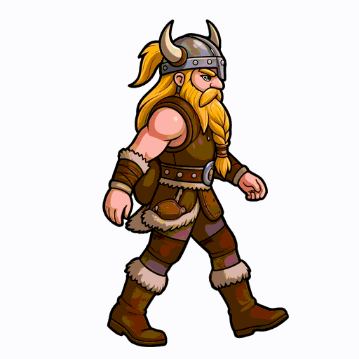
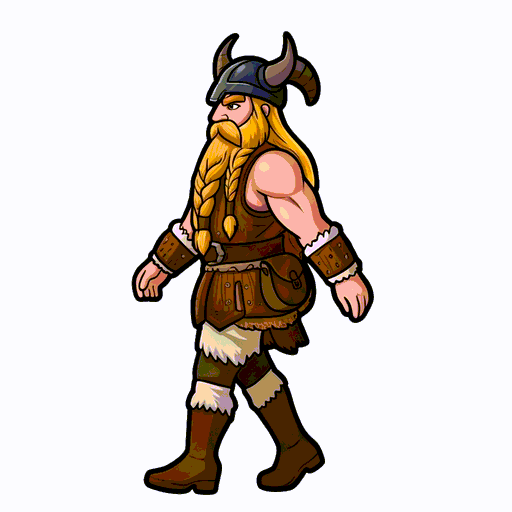
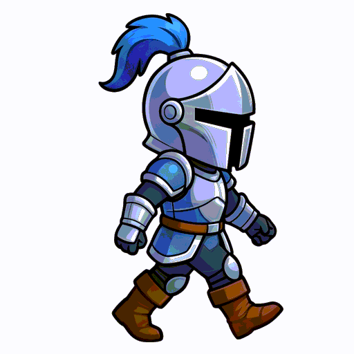
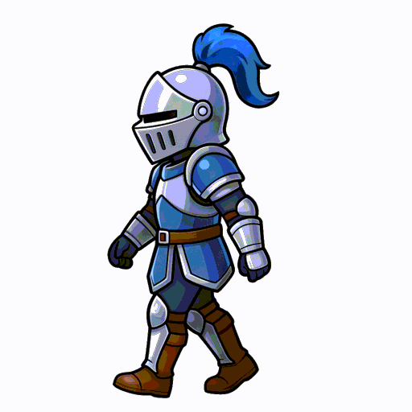

# iso_flutter

> **native 等距解释图 / 动画引擎**：Dart + Lua 双引擎（等价），Flutter 离屏渲染出 PNG / GIF / MP4 —— **无浏览器、无 node、无 JS**。

把 anatomy（等距插画）的引擎**全量移植为 Dart 与 Lua 两份等价实现**，在 **Flutter** 里渲染：
既能**交互**（拖拽开盖、实时特效），也能**离屏出图/出动画**（PNG/GIF/MP4，可发微信）。

## 展示：同一张图，Lua 与 Dart 两种实现

| **Lua 生成** | **Dart 生成** |
|:---:|:---:|
|  |  |
| `bin/iso.sh anim tmall-genie --motion` | `bin/iso.sh anim tmall-genie-dart --motion` |

> 天猫精灵 X1：等距图 + "唤醒→开盖→合上"动画。两版**逐像素一致**。
> 源文件：`example/tmall-genie/{tmall-genie.lua, tmall_genie.dart}`；产物：`example/res/{lua,dart}/`。

---

## 游戏（AI 游戏开发系统）· 蓝图

- **设计 / 图表**：本引擎（`iso_engine` + `bin/iso.sh`）→ 出**等距矢量图 / 图表**。
- **游戏运行时**：集成 **LÖVE**（开源 Lua 2D 引擎，`game/love/`）——渲染 / 输入 / 动画。
- **游戏逻辑**：**纯 Lua Sim**（`iso_engine/lib/lua/game/battle.lua`）——`luajit` headless 驱动（agent 测试/复现）+ LÖVE 渲染，**同一份**。
- **GUI 容器**：**Flutter**（`app/`，只做窗口 / 工具，不做游戏渲染）。
- 目标：**人类给"想法 + 意见"，AI 自己开发 / 试玩 / 看画面 / 迭代 → 一个游戏诞生**。
  详见 [`docs/ai-game-system.md`](docs/ai-game-system.md)、[`game/README.md`](game/README.md)。

### 游戏列表
| 游戏 | 位置 | 运行 |
|---|---|---|
| **兵线对推**（俯视 3/4 · 布兵对推 · 大招/旋斩） | `game/love/` | `love ~/iso_flutter/game/love` |
| **水晶方块**（俄罗斯方块 · q 版玻璃水晶块 · 纯 Lua Sim + 落子记忆 + 接口驱动 + Android 可玩） | `game/tetris/` | `love ~/iso_flutter/game/tetris`（手机见其 README） |

---

## 目录结构

```
iso_flutter/                       # 独立仓（自包含）
  bin/iso.sh                       # 入口 CLI：render / anim → PNG / GIF / MP4
  iso_engine/                      # 框架（Dart 包 name: iso_engine）
    lib/iso_kit.dart  iso_lathe.dart  iso_tube.dart   # 引擎（Dart，移植自 iso-kit/lathe/tube.mjs）
    lib/iso_render.dart                                # 渲染层：kit 线稿样式 → Canvas（Dart/Lua 图共用）
    lib/lua_bridge.dart                                # Dart ←FFI→ LuaJIT 桥
    lib/lua/{iso_kit,lathe,tube}.lua                   # 引擎（Lua，与 Dart 等价）—— 随包打成 assets
    tool/{kit_parity.dart,kit_parity.lua,parity.sh,lua_probe.dart}  # 对拍（parity.sh）/ 桥探针
  app/                             # 应用（Flutter name: iso_app，依赖 ../iso_engine）
    lib/main.dart                                      # 入口（ISO_EXPORT→导出，否则窗口）
    lib/ui.dart                                        # 交互窗口 + painter（整数缩放+2×超采样+缓存）
    lib/export.dart                                    # 离屏导出 CLI（ISO_* 环境变量）
    lib/figures.dart                                   # 图（Dart 版天猫精灵 + 测试图）+ 注册表
    lib/lua_figures.dart                               # Lua 图运行器（解包 assets→预编译→每帧调用→渲染）
    lib/lua/figures/tmall-genie.lua                    # 图（Lua 版天猫精灵）—— 打成 assets
    assets/fonts/
  docs/references/*.md             # 设计规范（craft/kit/motion…，来自 anatomy）
  docs/LICENSE-anatomy            # 署名（MIT）
```

---

## 架构与数据流

```
        图定义（content）
   ┌──────────────┴──────────────┐
   │ Dart                         │ Lua
   │ app/lib/main.dart            │ app/lib/lua/figures/*.lua
   │  的 _figures 注册的画图函数    │  (返回绘制指令 JSON)
   └──────────────┬──────────────┘
                  │                    ▲
        ┌─────────┴─────────┐          │ 内嵌 LuaJIT
        │ 引擎（geometry）    │◄─────────┘（dart:ffi 桥）
        │ Dart: iso_*.dart   │   Lua: iso_kit/lathe/tube.lua
        └─────────┬─────────┘
                  │ 路径串 / 绘制指令
        ┌─────────┴─────────┐
        │ 渲染层 iso_render  │  线稿样式 → Canvas（Dart/Lua 图共用）
        └─────────┬─────────┘
                  │
        ┌─────────┴─────────┐
        │ Flutter / Impeller │  ① 交互窗口（实时）  ② 离屏导出（CLI）
        └─────────┬─────────┘
                  │
            PNG / GIF / MP4   （bin/iso.sh → 可发微信）
```

分层：**应用（`app`）⊥ 框架（`iso_engine`）⊥ 内容（图）**。引擎通用；**加图 = 加一个画图函数或一个 `.lua`**，不动引擎。

---

## 技术栈

| | 技术 | 用途 |
|---|---|---|
| 渲染 | **Flutter + Impeller**（GPU） | 矢量→光栅；交互实时 + 离屏出图 |
| 语言① | **Dart** | 引擎 / 渲染层 / FFI 桥 / 应用 |
| 语言② | **Lua（LuaJIT）** | 引擎 / 图的脚本层（内嵌，可热改） |
| 桥 | **`dart:ffi`** → `libluajit-5.1.so.2` | Dart 跑 Lua、取回路径串 / JSON |
| 合成 | **ffmpeg** | 逐帧 PNG → GIF / MP4 |
| 字体 | **仓耳今楷02**（子集 14KB，随包 assets） | 中文标注 |

---

## 原理

### 等距投影
世界点 `[x,y,z]`（x/y 在地面、z 向上）投到 2D：**方位角 45°、俯仰角 30°**，比例 `k = scale·√1.6`。
"立体感"来自几何，不是 3D 引擎。函数：`iso([x,y,z], P)`、`fitProjection(...)`（自动取景居中）。

### 实心体建模（挤出 / 回转 / 扫掠）
- **挤出** `extrude(ring, z, height)`：地面轮廓向上挤出棱柱 → 产出 `fill / outline / crease / top / shades[4] / bevel`。
  封装：`slabOf`（圆角矩形盒）、`cylinder`（柱）、`prismOf`（任意多边形）。
- **回转体** `lathe(meridian)`：母线绕轴回转（含样条 `curveRuns/curved`、平滑着色 `smoothRows`、`surfaceOf` 轮廓）。
  封装：`disc / ringBand / solidOf / sphereOf / bandOfProfile`。
- **扫掠管** `tubePieces(path)`：圆沿 3D 路径扫掠（含端盖、条纹高光、环）。

### 明暗与遮挡
- 每个可见面按 **法向·光向** 分到 **4 档明暗**（`SHADES=4`），另有 top（顶面）、crease（折线）、outline（轮廓）。
- **Painter's order**：`depthOf = 点·视线`，同层从远到近画；运动件每帧重排。

### 线稿风格（"好看"的来源）
不是写实渲染，而是**单色线稿**：实体填充=**卡片底色**（≈镂空）；可见面=**4 档贴近底色**的微妙阴影；
边缘=**细线**（`hi/mid/lo/faint` 色阶）；`halo`=一层 **blur 软投影**。
> light 主题（白机身/浅底/深灰细边）才是"产品图"那版；dark 是深色线稿。（详见 `docs/references/craft.md`。）

---

## 双引擎：Dart 与 Lua（等价）

同一套几何有**两份实现**，接口同名：

| | Dart | Lua |
|---|---|---|
| 核心 | `iso_engine/lib/iso_kit.dart` `iso_lathe.dart` `iso_tube.dart` | `iso_engine/lib/lua/{iso_kit,lathe,tube}.lua` |

- **等价性**：同图两版输出**逐字符相同**（`iso_engine/tool/kit_parity.{dart,lua}`），渲染结果 RMSE≈1e-5。
- **Lua 路径**：`lua_bridge`（FFI）跑 Lua → 图的 `function(lift,time)` 返回**绘制指令 JSON** → Dart 解析 → 同一个渲染层画。
- **渲染层只有一份**（Dart）：Lua 只"算几何"，不重复画。

---

## 动画与交互

- **时间线**：抬升/开合等按归一化 `t∈[0,1]` 驱动（`--motion` 用 easeOutBack 缓动，带过冲）。
- **相位特效**：唤醒扩散波纹（带透明度衰减）、LED 环变亮、麦克风点呼吸、顶盖抬升**轻微倾斜**、软阴影随开合变化。
- **实时效**：可叠 **fragment shader**（如火焰那类 GPU 实时效果）。
- **交互**：Flutter 手势（拖拽开盖 + 弹簧/点击）。窗口渲染用 **整数倍缩放（1/2/3×）+ 离屏 2× 超采样**，让细线锐利、抗锯齿细腻。

---

## 构建 / 运行

```bash
export PATH="$HOME/development/flutter/bin:$PATH"
cd app && flutter build linux --release
./build/linux/x64/release/bundle/iso_app     # 交互窗口（左上 64×64 区域点一下切 dark/light）
```

**入口 CLI**（出图/出动画）：
```bash
bin/iso.sh render <图名> [--ss 2] [--lift 0..1] [--theme dark|light] [--out DIR]
bin/iso.sh anim   <图名> [--frames 120] [--motion] [--ss 2] [--out DIR]
```
（打印生成文件路径；`my-agent` 的 `operator/tools/iso_native.sh` 调它并发送到微信。）

**图名**（`app/lib/main.dart` 的 `_figures`）：
- `tmall-genie` —— 天猫精灵（**Lua**，默认）
- `tmall-genie-dart` —— 天猫精灵（**Dart** 参考实现，与 Lua 逐像素一致）
- `lathe` / `tube` —— 引擎测试图

---

## 出图 / 出动画流水线

1. **离屏渲染**（`PictureRecorder` → `toImage` → PNG），2× 超采样；
2. **批量**：`ISO_BATCH` 一次进程内渲染全部帧（120 帧 ≈ 19s），不再逐帧起进程；
3. **合成**：ffmpeg → GIF + MP4（60fps）。

导出由环境变量驱动（同一份代码）：`ISO_EXPORT / ISO_FRAME / ISO_N / ISO_BATCH / ISO_MOTION / ISO_LIFT / ISO_THEME / ISO_SS / ISO_OUT`。

---

## 游戏角色走路动画：骨架 → 低清帧 → Nano 4K 精灵图 → 透明 PNG/Atlas

> 目标：输入一个角色提示词，产出 **16 帧、同角色、步态丝滑、1024×1024 的透明 PNG**，
> 一张 **4096×4096 的 4×4 透明 atlas**、左右向 manifest，以及预览 GIF。按本节命令从零可复现。
>
> 关键思路：**先让 AnimateDiff 出“步态对但糊”的 16 帧 → 拼成 4×4 接触表 →
> 让 Nano Banana 一次重绘整张精灵图**。16 个姿势在同一张图里，角色身份天然锁死；
> 再用 StaticPy `cutout` 抠透明、`align_head` 对齐、`pack_sprites` 打 atlas，
> 预览 GIF 只是附带。逐帧放大/重绘一定会让人物漂移，别走那条路。

### 效果预览

**姿势参考（Viking，已验证的 16 帧步态）**

| 大步 · 朝右（512×512） | 小步 · 朝左（512×512） |
|:---:|:---:|
|  |  |

**换角色（Knight，同一套 16 帧姿势，只换角色/高清）**

| 大步 · 朝右（512×512） | 小步 · 朝左（512×512） |
|:---:|:---:|
|  |  |

> 同一张 16 帧姿势表，Nano 只负责换角色/高清；帧序、步幅、脚底基线保持不变。

```
pose_walk（16 张 OpenPose 骨架）
      ↓
dw_anim.sh（DreamShaper 8 + AnimateDiff + ControlNet）→ 512×512×16 低清源
      ↓
pack_sprites → 4×4 参考接触表（2048×2048）
      ↓
Nano Banana --ref --res 4K → 4096×4096 精灵图（4×4，同一角色）
      ↓
cutout（4K 白底 → 透明 16 角色）
      ↓
split_grid（4×4 行优先切格）→ align_head（头盔 x=512 / 脚底 y=990）
      ↓
pack_sprites（4096 atlas + manifest；FLIP=1 出左向）
      ↓
flatten + frames_to_gif（预览 GIF；运行时用 PNG）
```

### 0. 环境与依赖

需要：

- 本仓库：`~/iso_flutter`
- StaticPy：`/opt/StaticPy`（`pose_walk`、`imgproc`、`cutout`、`pack_sprites`、`frames_to_gif`）
- static_comfyui：`/opt/static_comfyui`（`anim.sh`；低清条纹帧才用 `bgremove.sh`）
- 模型：
  - `/models/DreamShaper_8.safetensors`
  - `/data/models/image/video/vae-ft-mse.safetensors`
  - `/data/models/image/video/mm_v2_prefixed.safetensors`
  - `/data/models/image/video/walkRL_conv.safetensors`
  - `/data/models/image/controlnet/control_openpose-fp16.safetensors`
- 素材后处理：**StaticPy ELF**（`cutout` / `align_head` / `pack_sprites` / `flatten` / `frames_to_gif` / `flip`）
- Nano Banana key：`~/.env` 里有 `APIMART_API_KEY=...`
- **不再需要** Python/Pillow/numpy/ImageMagick/ffmpeg 做素材处理

```bash
cd ~/iso_flutter
mkdir -p ~/iso_gen/tmp
test -f ~/.env && grep -q APIMART_API_KEY ~/.env && echo "Nano key OK" || echo "缺少 APIMART_API_KEY"
```

> **单卡注意**：不要同时跑 big / small 两个生成；会 OOM。一次跑一个，约 3–4 分钟/版。

### 1. 生成 16 帧 OpenPose 骨架

`pose_walk` 是 StaticPy 的 C++ 骨架生成器（无 torch）。`LEGX` 控制步幅，`YUP` 抬高留头空间，`HAND=1` 带手部关键点。

```bash
cd ~/iso_flutter
export LD_LIBRARY_PATH=/opt/StaticPy/cpp/imgproc/build:${LD_LIBRARY_PATH:-}

# big：大步
mkdir -p ~/iso_gen/viking_pose_big
OUTDIR=$HOME/iso_gen/viking_pose_big \
  HAND=1 LEGX=1.0 YUP=80 /opt/StaticPy/anim/pose_walk

# small：小步
mkdir -p ~/iso_gen/viking_pose_small
OUTDIR=$HOME/iso_gen/viking_pose_small \
  HAND=1 LEGX=0.5 YUP=80 /opt/StaticPy/anim/pose_walk
```

产物：每个目录 `f00.png … f15.png`，**512×848**。这只是 ControlNet 骨架，不直接给 Nano。

检查：

```bash
file ~/iso_gen/viking_pose_big/f00.png
# PNG image data, 512 x 848
```

> 如果报 `libimgproc.so: cannot open shared object file`，就是漏了上面的
> `export LD_LIBRARY_PATH=/opt/StaticPy/cpp/imgproc/build`。

### 2. 生成低清但步态丝滑的 16 帧

固定 prompt / negative。**big 与 small 只换骨架目录和输出目录**，模型、seed、prompt 完全一致。

```bash
cd ~/iso_flutter
export LD_LIBRARY_PATH=/opt/StaticPy/cpp/imgproc/build:${LD_LIBRARY_PATH:-}
mkdir -p ~/iso_gen/tmp

PROMPT='a cute chibi cartoon male viking warrior, horned iron helmet, long braided blonde beard, brown leather armor with fur trim, leather boots, empty hands, vibrant colors, walking to the right, side view, full body, arms swinging naturally in sync with the legs, plain white background, thick clean outline, flat colors, smooth 2d game character animation'
NEG='female, girl, woman, sword, weapon, shield, broom, brush, object in hand, back accessory, arms crossed, folded arms, hands on hips, stiff arms, blurry, low quality, deformed limbs, extra limbs, static, gray background, scenery, objects, realistic, photo, 3d render'

gen() {
  local pose_dir="$1" out_dir="$2"
  TMPDIR=$HOME/iso_gen/tmp \
  POSE_DIR="$pose_dir" POSE_FLIP=1 CONTROL_STRENGTH=0.55 \
  MODEL=/models/DreamShaper_8.safetensors \
  VAE=/data/models/image/video/vae-ft-mse.safetensors \
  MOTION=/data/models/image/video/mm_v2_prefixed.safetensors \
  LORA=/data/models/image/video/walkRL_conv.safetensors LORA_STRENGTH=1.0 \
  CONTROL_NET=/data/models/image/controlnet/control_openpose-fp16.safetensors \
  OUT="$out_dir" W=512 H=512 FRAMES=16 FPS=8 STEPS=25 CFG=7.5 SEED=42 \
  PROMPT="$PROMPT" NEG="$NEG" ./dw_anim.sh
}

gen "$HOME/iso_gen/viking_pose_big"   "$HOME/iso_gen/viking_ds_test2"   # big
gen "$HOME/iso_gen/viking_pose_small" "$HOME/iso_gen/viking_ds_small"   # small
```

参数别乱改：

| 参数 | 值 | 说明 |
|---|---|---|
| `FRAMES` | `16` | AnimateDiff `context_length=16`；8 帧会出条纹/巨大背景物 |
| `POSE_FLIP` | `1` | 翻转骨架，修“太空步/倒退”；腿和脸必须同向 |
| `CONTROL_STRENGTH` | `0.55` | 骨架控制强度 |
| `LORA` | `walkRL_conv` | 必须用 conv 版；`walkRL_diff` 是 diffusers 格式，sd.cpp 不生效 |
| `SEED` | `42` | big/small 保持同一个 seed |

### 3. StaticPy 素材工具（构建）

> **分工**：Nano / AnimateDiff / BiRefNet 只负责“出图 / 抠图”；
> 所有确定性素材处理（切格、对齐、atlas、manifest、GIF、左右翻转）全部用 **StaticPy ELF**，
> 不依赖 Python / Pillow / numpy / ImageMagick / ffmpeg。

```bash
cd ~/iso_flutter
export LD_LIBRARY_PATH=/opt/StaticPy/cpp/imgproc/build:${LD_LIBRARY_PATH:-}

# 已有：
#   /opt/StaticPy/cutout                    # 4K 白底精灵图 → 透明角色
#   /opt/StaticPy/anim/pack_sprites         # 透明帧 → atlas + manifest（支持 FLIP=1）
#   /opt/StaticPy/anim/frames_to_gif        # 帧序列 → 预览 GIF
# 本仓新增/重写（源码在 tools/*.static.py）：
for t in split_grid align_head flip flatten; do
  bash /opt/StaticPy/imgproc/build_app.sh "tools/${t}.static.py" "$t"
  cp "/opt/StaticPy/$t" "bin/$t"
  cp "/opt/StaticPy/$t.so" "bin/$t.so"
done
chmod +x bin/split_grid bin/align_head bin/flip bin/flatten
```

| 工具 | 作用 |
|---|---|
| `cutout` | 4K 白底精灵图 → 透明角色（洪泛去背景 + 连通块保留） |
| `split_grid` | 4×4 精灵表按**行优先**切成 16 格（避免 cutout 组件顺序错乱） |
| `align_head` | 头盔中心 → x、脚底 → y，对齐到固定透明画布 |
| `pack_sprites` | 透明帧 → 4×4 atlas + `manifest.json`；`FLIP=1` 出左向 |
| `flatten` | 透明 PNG → 纯白底（只用于预览 GIF） |
| `frames_to_gif` | 帧序列 → 循环 GIF |
| `flip` | 单帧/GIF 水平镜像（左走 ↔ 右走） |

> `cutout` 是纯 StaticPy 算法，不调用模型；低清 DreamShaper 帧如果背景有横条纹，
> 仍用 `bgremove.sh`（BiRefNet）抠，再用 `align_head` 对齐。4K Nano 精灵图是纯白底，
> 直接用 `cutout` 更干净。

### 4. 低清 16 帧 → 4×4 参考表（StaticPy）

已有 `~/iso_gen/viking_big_final/frame_001..016.png`（512×512 白底）时，直接拼参考表：

```bash
/opt/StaticPy/anim/pack_sprites \
  ~/iso_gen/sprite_ref_big.png ~/iso_gen/sprite_ref_big.json \
  512 512 0 0 512 512 4 0 ref_big \
  ~/iso_gen/viking_big_final/frame_*.png

/opt/StaticPy/anim/pack_sprites \
  ~/iso_gen/sprite_ref_small.png ~/iso_gen/sprite_ref_small.json \
  512 512 0 0 512 512 4 0 ref_small \
  ~/iso_gen/viking_small_final/frame_*.png

file ~/iso_gen/sprite_ref_big.png
# PNG image data, 2048 x 2048
```

从 AnimateDiff 原始帧重建低清对齐帧（只有 `bgremove` 是模型，之后全是 StaticPy）：

```bash
RAW=~/iso_gen/viking_ds_test2
mkdir -p ~/iso_gen/lowres_big_alpha ~/iso_gen/lowres_big
for f in "$RAW"/frame_*.png; do
  bash /opt/static_comfyui/cpp/sd/bgremove.sh \
    "$f" "$HOME/iso_gen/lowres_big_alpha/$(basename "$f")" transparent
done
bin/align_head ~/iso_gen/lowres_big 512 512 256 495 \
  ~/iso_gen/lowres_big_alpha/frame_*.png
/opt/StaticPy/anim/pack_sprites \
  ~/iso_gen/sprite_ref_big.png ~/iso_gen/sprite_ref_big.json \
  512 512 0 0 512 512 4 0 ref_big \
  ~/iso_gen/lowres_big/f*.png
```

> `align_head` 会自己算 bbox / 头盔中心 / 脚底，不再需要手填 312x461 之类 bbox。
> 这样换角色、换 prompt、换 seed 都不用改裁剪参数。

### 5. Nano Banana 重绘 4K 精灵图

一次出 16 格；**不要逐帧重绘**。`--ref` 必须是上一步的接触表，且 big / small 各用各的。

```bash
cd ~/iso_flutter
mkdir -p ~/iso_gen/nano_sprite ~/iso_gen/nano_sprite_small

NANO_PROMPT='Redraw this exact 4x4 character sprite sheet as a clean, high-detail game sprite sheet. Keep EXACTLY the same 16 walking-cycle poses in the same row-major order and the same character design. Character: cute chibi male Viking warrior, horned iron helmet, long braided golden blonde hair and long braided golden blonde beard, brown leather armor with fur trim, leather boots, empty hands. Exactly 16 equal cells in a 4x4 grid, one full-body character per cell, same scale and same foot baseline, centered, no overlap, no cropping. Plain pure white background in every cell. Clean thick outlines, flat colors, sharp details, crisp edges. No text, no labels, no borders, no grid lines, no shadows, no extra characters, no weapons. Do not change the poses or the walk cycle; only increase clarity and detail.'

bin/img_nano.sh "$NANO_PROMPT" \
  --ref ~/iso_gen/sprite_ref_big.png --size 1:1 --res 4K \
  --out ~/iso_gen/nano_sprite --prefix viking_sprite

bin/img_nano.sh "$NANO_PROMPT This is the SMALL-STEP walk version: keep the shorter stride exactly as shown." \
  --ref ~/iso_gen/sprite_ref_small.png --size 1:1 --res 4K \
  --out ~/iso_gen/nano_sprite_small --prefix viking_sprite_small
```

产物：`viking_sprite_*.jpg` / `viking_sprite_small_*.jpg`，**4096×4096**，4×4 共 16 格。

出图后先 **Read 看图自检**：

- 必须正好 4×4、16 格、无文字/边框/网格线；
- 每格一个完整角色，脚底基线基本一致；
- 16 格是同一张脸/发/盔/甲；
- 姿势顺序与参考表 row-major 一致。

> 若不满意，重跑一次（可加 `--n 2` 出两张挑一张）；或把
> “same character design / do not change the helmet and armor”写得更重。
> 这是**重绘**，铆钉/缝线等小细节会与旧版略有差异；要逐像素保留旧细节只能手工修，
> 但逐帧生成一定会漂。

### 6. 4K 白底精灵图 → 透明 PNG（StaticPy cutout）

```bash
SPRITE=$(ls -t ~/iso_gen/nano_sprite/viking_sprite_*.jpg | head -1)
WORK=~/iso_gen/nano_sprite/staticpy
rm -rf "$WORK"; mkdir -p "$WORK/cut" "$WORK/cells" "$WORK/aligned1024"
export LD_LIBRARY_PATH=/opt/StaticPy/cpp/imgproc/build:${LD_LIBRARY_PATH:-}

/opt/StaticPy/cutout "$SPRITE" "$WORK/cut" 1500 | tee "$WORK/cut.log"
# 正常输出：components=16 / kept=16；cut/aura_cut.png 是完整透明 4K 表
```

- `cutout` 从四边洪泛去白底，保留 >= `SIZE_TH` 的连通块；不调用模型，输出透明 RGBA。
- **不要用 `cut/f00..f15` 的顺序**：`cutout` 组件按最左 x 输出，不保证严格行优先；
  直接拼 GIF 会帧序错乱（之前的问题）。
- 只取 `cut/aura_cut.png`（完整 4K 透明图），下一步按 4×4 **行优先**切格。
- `SIZE_TH=1500` 适合这个角色（单角色约 20 万像素）。多出/少于 16 个时调大/调小。
- 不要用 `bgremove.sh white`（会输出全白）；这里直接用 `cutout` 的透明输出。
- **small**：把 `nano_sprite` → `nano_sprite_small`，`viking_sprite_*` → `viking_sprite_small_*`；其余命令相同。

### 7. 行优先切格 + 头盔/脚底对齐（split_grid + align_head）

```bash
WORK=~/iso_gen/nano_sprite/staticpy

# aura_cut.png (4096×4096) → 4×4 行优先 cells/f00..f15.png
bin/split_grid "$WORK/cut/aura_cut.png" "$WORK/cells" 4 4

# cells/f00..f15 行优先 → 1024×1024 透明帧
bin/align_head "$WORK/aligned1024" 1024 1024 512 990 "$WORK"/cells/f*.png
file "$WORK/aligned1024/f00.png"
# PNG image data, 1024 x 1024, 8-bit/color RGBA
```

`split_grid` 按 `(row, col)` 顺序输出，保证：

```text
f00 f01 f02 f03
f04 f05 f06 f07
f08 f09 f10 f11
f12 f13 f14 f15
```

`align_head` 做三件事：

1. 每帧求 alpha bbox；
2. 取 bbox 顶部 300px 内 alpha 内容的水平中点当**头盔中心**；
3. 把 bbox 贴到 1024×1024 透明画布：头盔中心 → `x=512`，脚底 → `y=990`。

**不缩放**，保留原始步幅和上下起伏；输出 `aligned1024/f00..f15.png`，可直接进引擎。
> 之前 GIF 帧序乱的根因：`cutout` 的 `fNN` 按最左 x 输出，不是严格行优先。
> 现在只取 `aura_cut.png`，用 `split_grid` 按行优先切格；新 GIF 与旧 approved GIF 16/16 对得上。

### 8. Atlas + manifest + 左右翻转（StaticPy）

```bash
WORK=~/iso_gen/nano_sprite/staticpy
cd "$WORK"
/opt/StaticPy/anim/pack_sprites \
  atlas_right_4096.png manifest_right.json \
  1024 1024 0 0 1024 1024 4 0 walk_right aligned1024/f*.png

/opt/StaticPy/anim/pack_sprites \
  atlas_left_4096.png manifest_left.json \
  1024 1024 0 0 1024 1024 4 1 walk_left aligned1024/f*.png
```

- 输出 **4096×4096 RGBA**，4×4，每格 1024。
- `FLIP=1` 是**逐格**水平镜像，帧顺序不变；这是“左走转右走”的正确做法。
  源是右走 → 出左走；源是左走 → 出右走。manifest 的 `NAME` 要跟着方向改。
- **不要**直接对整张 4×4 精灵表做一次 `flip`：那会把列顺序也反过来，动画会倒放。
- `flip` 工具用于单帧/序列/GIF：

```bash
# 左走 → 右走
bin/flip walk_left.png walk_right.png
# 右走 → 左走
bin/flip right.png left.png
mkdir -p left_frames
for f in aligned1024/f*.png; do
  bin/flip "$f" "left_frames/$(basename "$f")"
done
bin/flip preview_white_1024.gif preview_white_1024_left.gif
```

> 纯镜像会交换左右不对称的装备（例如腰包、盾牌、武器手）。走路通常没问题；
> 攻击/持盾角色如果左右手有明确语义，最好重新用对应骨架生成，而不是只翻转。

manifest 示例：

```json
{
  "name": "walk_right",
  "image": "atlas_right_4096.png",
  "frameWidth": 1024,
  "frameHeight": 1024,
  "columns": 4,
  "rows": 4,
  "frameCount": 16,
  "animations": { "walk_right": { "from": 0, "to": 15, "fps": 8, "loop": true } }
}
```

引擎锚点：**脚底中心**，`pivot = (0.5, 990 / 1024 = 0.966796875)`。
`manifest.json` 目前不写 pivot，导入时在引擎里设置；或按你的 manifest schema 加字段。

移动端要更小，可让 `pack_sprites` 直接出 2048（每格 512）：

```bash
/opt/StaticPy/anim/pack_sprites \
  atlas_right_2048.png manifest_right_2048.json \
  1024 1024 0 0 512 512 4 0 walk_right aligned1024/f*.png
```

### 9. 预览 GIF（StaticPy）

```bash
WORK=~/iso_gen/nano_sprite/staticpy
```

GIF 只是预览，**游戏运行时用 PNG atlas / 透明帧**。StaticPy 的 `frames_to_gif`
不做白底合成，所以先把透明帧压到白底，再拼：

```bash
cd "$WORK"
mkdir -p flat1024
for f in aligned1024/f*.png; do
  bin/flatten "$f" "flat1024/$(basename "$f")" 4294967295
done
/opt/StaticPy/anim/frames_to_gif preview_white_1024.gif 8 flat1024/f*.png
```

- `4294967295` = `0xFFFFFFFF`，不透明白。
- 直接对透明帧跑 `frames_to_gif` 会得到黑底（GIF 只有 1-bit 透明），不适合预览。
- 左向预览：`bin/flip preview_white_1024.gif preview_white_1024_left.gif`。

### 10. 游戏素材专业处理清单（还需要这些）

| 项 | 做法 / 标准 |
|---|---|
| 透明 alpha | `cutout` 输出 RGBA；在棋盘格上检查无白边、无洞、角/靴不被裁 |
| 对齐 | `align_head`：头盔中心 x=512，脚底 y=990，不缩放 |
| 帧序 | `split_grid` 按 4×4 行优先切 `aura_cut.png`；不要用 `cutout` 的 fNN 顺序 |
| Atlas | 4096×4096 POT，4×4，1024/格，RGBA；左右各一份 |
| Pivot / 锚点 | 脚底中心 `(0.5, 0.966796875)`；角色挂在脚底，不挂图片中心 |
| Metadata | `manifest.json`：`frameWidth/Height`、`columns/rows`、`frameCount`、`fps`、`loop`、`name` |
| 颜色 | sRGB；带 alpha 的素材不要存 JPG；PNG 无损 |
| 压缩 | master 保持无损；发布可 `oxipng`；不要对 master 用 pngquant |
| 边距 / bleed | 4×4 格子贴边；角色本身有透明留白。若线性过滤出现接缝，给 atlas 加 4–8px gutter/extrusion |
| 移动端 | 用 2048 atlas（512/格）；先真机看缩放后的锯齿/接缝 |
| 左右向 | 右向 `FLIP=0`，左向 `FLIP=1`；不要翻转整张表 |
| 命名/版本 | `viking_walk_big_v1_atlas_right_4096.png` + `manifest_right.json` + `preview.gif` |
| 引擎导入 | LÖVE：`newQuad(col*1024,row*1024,1024,1024,4096,4096)`；Godot：`AtlasTexture` + `AnimatedSprite2D`；Unity：Multiple + 4×4 切片 + Animator；Flame：`SpriteAnimation` |
| 回归 QA | 循环接缝、左右镜像一致、cell 0 == `aligned1024/f00.png`、`motion.sh` 非静止 |

本套实测：

```bash
bin/motion.sh ~/iso_gen/nano_sprite/staticpy/aligned1024 'f*.png'
# 16 帧，平均变化 ~0.1233，近似静止 0/15
bin/motion.sh ~/iso_gen/nano_sprite_small/staticpy/aligned1024 'f*.png'
# 16 帧，平均变化 ~0.1253，近似静止 0/15
```

- 头盔中心：512.0–512.5（std ~0.24），脚底：989。
- atlas 第 0 格与 `aligned1024/f00.png` RMSE = 0；左 atlas 第 0 格与右 atlas 镜像 RMSE = 0。
- 1024 预览 GIF 约 0.9MB；4096 atlas 约 8–9MB。

### 11. 产物清单

```text
~/iso_gen/nano_sprite/staticpy/
  cut/aura_cut.png                 # 4K 透明总图
  cut/f00..f15.png                 # cutout 组件（顺序不可靠，仅调试）
  cells/f00..f15.png               # split_grid 行优先切格
  aligned1024/f00..f15.png         # 1024×1024 透明，头盔 512 / 脚底 990
  atlas_right_4096.png             # 右向 4×4 atlas
  manifest_right.json
  atlas_left_4096.png              # 左向 4×4 atlas
  manifest_left.json
  flat1024/                        # 白底预览帧
  preview_white_1024.gif
  preview_white_1024_left.gif      # bin/flip 左向预览
  preview.gif                      # 透明帧直出（黑底，仅调试）
  atlas_right_2048.png             # 可选移动端
  manifest_right_2048.json

~/iso_gen/nano_sprite_small/staticpy/
  ... 同上（small）

# 方便直接看的预览（512×512，仓库根也有同名副本）
~/viking_walk_big_512.gif
~/viking_walk_small_512_left.gif
~/knight_big.gif
~/knight_small_left.gif

# 低清源 / 参考表
~/iso_gen/viking_pose_big/f00..f15.png
~/iso_gen/viking_pose_small/f00..f15.png
~/iso_gen/viking_ds_test2/          # 低清 big 原始帧
~/iso_gen/viking_ds_small/
~/iso_gen/viking_big_final/frame_001..016.png
~/iso_gen/viking_small_final/frame_001..016.png
~/iso_gen/sprite_ref_big.png        # 2048×2048 Nano 参考
~/iso_gen/sprite_ref_small.png
~/iso_gen/nano_sprite/viking_sprite_*.jpg       # 4096×4096 白底精灵图
~/iso_gen/nano_sprite_small/viking_sprite_small_*.jpg
```

旧版 `~/iso_gen/nano_sprite/frames_alpha/`（BiRefNet 软 alpha）和
`viking_walk_*_sprite.gif`（1024 白底预览）保留作历史；**正式游戏素材用 `staticpy/`**。

### 12. 常见问题

| 现象 | 原因 | 处理 |
|---|---|---|
| `libimgproc.so` 找不到 | 没设 `LD_LIBRARY_PATH` | `export LD_LIBRARY_PATH=/opt/StaticPy/cpp/imgproc/build:$LD_LIBRARY_PATH` |
| `load-program ... .so` 找不到 | 只复制了 ELF，没复制同名 `.so` | `cp /opt/StaticPy/<tool>.so bin/` |
| `cutout` 不是 16 个 | 背景不是纯白 / 小碎块 / 角色粘连 | 纯白底、调 `SIZE_TH`；看 `cut.log` 的 `components/kept` |
| 动画顺序乱 | 用了 `cutout` 的 fNN 组件顺序 | 用 `split_grid` 从 `aura_cut.png` 行优先切格；见 §7 |
| 角色左右滑 | 只做了 bbox 居中，没锁头盔中心 | 用 `align_head`，不要用 `sheet_align` 的 bbox 居中 |
| 脚底上下跳 | 没锁脚底基线 | `align_head ... 1024 1024 512 990` |
| 左走翻右走后倒放 | 翻转了整张 4×4 表 | 用 `pack_sprites ... FLIP=1` 或逐帧 `flip`，不要翻整表 |
| 腰包/盾牌换边 | 纯镜像 | 走路可接受；有语义的装备重新生成 |
| GIF 黑底 | 透明帧直接拼 GIF | `bin/flatten` 白底后再 `frames_to_gif` |
| 白边/毛边 | 用了 `bgremove white` 或白底 JPG | 用 `cutout` 的透明 RGBA；棋盘格检查 |
| atlas 接缝 | 线性过滤 + 贴边 | 加 gutter/extrusion，或移动端用 2048/nearest |
| 4096 atlas 太大 | 4K 全量 | 出 2048（512/格）；master 保留 4096 |
| OOM | 同时跑 big/small | 生成阶段一次一个；StaticPy 后处理不吃显存 |
| Nano 角色细节变了 | 精灵图是重绘 | 接受线稿化差异；要旧版逐像素细节只能手工修 |

> 更长的背景、失败分支（Wan VACE、Qwen 逐帧、HiResFix、ESRGAN 对比）见
> [`WALK_ANIM.md`](WALK_ANIM.md) §9–§11；回归检查项见
> [`docs/TESTING.md`](docs/TESTING.md) A7–A11。

---

## 自包含与桥

- **Lua 随包打成 assets**：引擎 `iso_engine/lib/lua/` + 图 `app/lib/lua/figures/`；运行时经 **`package.preload`** 注册（源码作字符串，**免落盘**）—— 不依赖开发机路径。
- **唯一外部依赖**：系统 `libluajit-5.1.so.2`（`lua_bridge` 用 `dart:ffi` 加载）。
- 字体 / 着色器随包（`app/assets/`、`app/shaders/`）。

---

## 扩展：加一张图

- **Lua**：`app/lib/lua/figures/` 加 `xxx.lua`（`return function(lift,time) → 绘制指令 JSON`），在 `_figures` 注册 `'xxx'`。
- **Dart**：`main.dart` 写 `xxxFigure(canvas, palette, lift, time)`，注册 `'xxx'`。
- 然后 `cd app && flutter build linux --release`；`bin/iso.sh render xxx` 出图。
- **写图前先读 [`AGENTS.md`](AGENTS.md)**（把 `docs/references/{craft,kit,motion,verify}.md` 定为必读规范）。

---

## 设计与性能要点

**设计**
- **框架 ⊥ 内容**：引擎通用；**Lua 图自动注册**（图名 = 文件名，丢个 `.lua` 即多一张图）。
- **渲染层一份共用**：图只"摆零件 + 动画"，Lua 只算几何 → 绘制指令 JSON，画由 Dart 统一。
- **线质**：窗口用**整数倍缩放（1/2/3×）+ 离屏 2× 超采样**（避免小数缩放糊线）。
- **Lua 桥**：每次调用**清栈**（防泄漏）；库名**多候选**（`ISO_LUAJIT` 可指定）。
- **自包含**：Lua 源码经 **`package.preload`** 注册（免落盘）；字体随包。

**性能**（实测）
- **Lua 几何 ≈ 3ms/帧**，而**渲染 + 编码 ≈ 130ms/帧** → 瓶颈在渲染，不在几何。
- 窗口：**渲染结果按（图, lift, time, 主题）缓存**，静止时不再重渲；`parsePath`（`d`→Path）带缓存。
- 出动画：帧用**原始 RGBA 单文件** → `ffmpeg rawvideo`（省掉 PNG 编码与解码）→ **120 帧 ≈ 6.6s**（PNG 路径 ≈ 17s）。
- Lua 图**预编译一次**（启动 `require` + 持有图函数，每帧只 `call`），不再每帧 `dofile`。

---

## 署名

绘图引擎与美术源自开源项目 **anatomy**（MIT）· https://github.com/wheresryan22/anatomy
`iso_engine/lib/{iso_*.dart, lua/*.lua}` 为其 `kit/iso-kit.mjs`/`lathe.mjs`/`tube.mjs` 及 CSS 的移植。
许可见 `docs/LICENSE-anatomy`，**请勿删除署名**。
