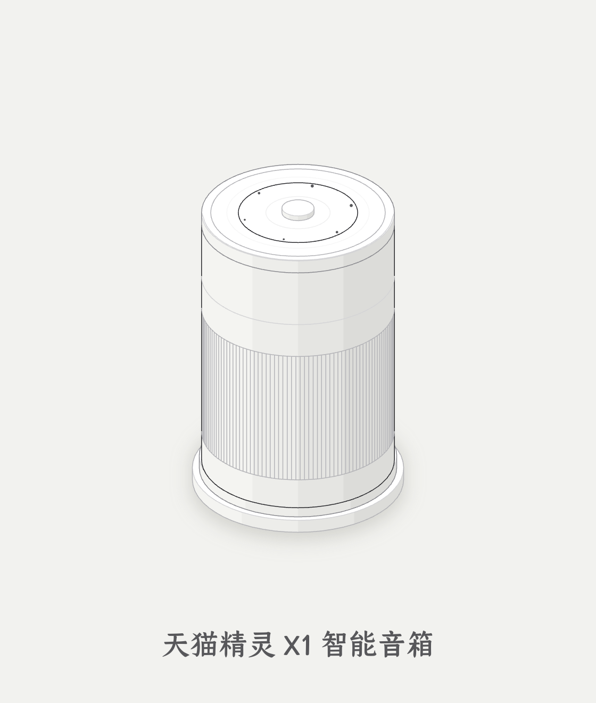

# iso_flutter

> **native 等距解释图 / 动画引擎**：Dart + Lua 双引擎（等价），Flutter 离屏渲染出 PNG / GIF / MP4 —— **无浏览器、无 node、无 JS**。

把 anatomy（等距插画）的引擎**全量移植为 Dart 与 Lua 两份等价实现**，在 **Flutter** 里渲染：
既能**交互**（拖拽开盖、实时特效），也能**离屏出图/出动画**（PNG/GIF/MP4，可发微信）。

## 展示：同一张图，Lua 与 Dart 两种实现

| **Lua 生成** | **Dart 生成** |
|:---:|:---:|
|  |  |
| `bin/iso.sh anim tmall-genie --motion` | `bin/iso.sh anim tmall-genie-dart --motion` |

> 天猫精灵 X1：等距图 + "唤醒→开盖→合上"动画。两版**逐像素一致**。
> 源文件：`example/tmall-genie/{tmall_genie.lua, tmall_genie.dart}`；产物：`example/res/{lua,dart}/`。

---

## 目录结构

```
iso_flutter/                       # 独立仓（自包含）
  bin/iso.sh                       # 入口 CLI：render / anim → PNG / GIF / MP4
  iso_engine/                      # 框架（Dart 包 name: iso_engine）
    lib/iso_kit.dart  iso_lathe.dart  iso_tube.dart   # 引擎（Dart，移植自 iso-kit/lathe/tube.mjs）
    lib/iso_render.dart                                # 渲染层：kit 线稿样式 → Canvas（Dart/Lua 图共用）
    lib/lua_bridge.dart                                # Dart ←FFI→ LuaJIT 桥
    lib/lua/{iso_kit,lathe,tube}.lua                   # 引擎（Lua，与 Dart 等价）—— 随包打成 assets
    tool/{kit_parity.dart,kit_parity.lua,lua_probe.dart}  # 对拍 / 桥探针
  app/                             # 应用（Flutter name: iso_app，依赖 ../iso_engine）
    lib/main.dart                                      # 窗口 + 导出 CLI + 图注册表 _figures
    lib/lua/figures/tmall_genie.lua                    # 图（Lua 版天猫精灵）—— 打成 assets
    assets/fonts/  shaders/
  docs/references/*.md             # 设计规范（craft/kit/motion…，来自 anatomy）
  docs/LICENSE-anatomy            # 署名（MIT）
```

---

## 架构与数据流

```
        图定义（content）
   ┌──────────────┴──────────────┐
   │ Dart                         │ Lua
   │ app/lib/main.dart            │ app/lib/lua/figures/*.lua
   │  的 _figures 注册的画图函数    │  (返回绘制指令 JSON)
   └──────────────┬──────────────┘
                  │                    ▲
        ┌─────────┴─────────┐          │ 内嵌 LuaJIT
        │ 引擎（geometry）    │◄─────────┘（dart:ffi 桥）
        │ Dart: iso_*.dart   │   Lua: iso_kit/lathe/tube.lua
        └─────────┬─────────┘
                  │ 路径串 / 绘制指令
        ┌─────────┴─────────┐
        │ 渲染层 iso_render  │  线稿样式 → Canvas（Dart/Lua 图共用）
        └─────────┬─────────┘
                  │
        ┌─────────┴─────────┐
        │ Flutter / Impeller │  ① 交互窗口（实时）  ② 离屏导出（CLI）
        └─────────┬─────────┘
                  │
            PNG / GIF / MP4   （bin/iso.sh → 可发微信）
```

分层：**应用（`app`）⊥ 框架（`iso_engine`）⊥ 内容（图）**。引擎通用；**加图 = 加一个画图函数或一个 `.lua`**，不动引擎。

---

## 技术栈

| | 技术 | 用途 |
|---|---|---|
| 渲染 | **Flutter + Impeller**（GPU） | 矢量→光栅；交互实时 + 离屏出图 |
| 语言① | **Dart** | 引擎 / 渲染层 / FFI 桥 / 应用 |
| 语言② | **Lua（LuaJIT）** | 引擎 / 图的脚本层（内嵌，可热改） |
| 桥 | **`dart:ffi`** → `libluajit-5.1.so.2` | Dart 跑 Lua、取回路径串 / JSON |
| 合成 | **ffmpeg** | 逐帧 PNG → GIF / MP4 |
| 字体 | **仓耳今楷02**（子集 14KB，随包 assets） | 中文标注 |

---

## 原理

### 等距投影
世界点 `[x,y,z]`（x/y 在地面、z 向上）投到 2D：**方位角 45°、俯仰角 30°**，比例 `k = scale·√1.6`。
"立体感"来自几何，不是 3D 引擎。函数：`iso([x,y,z], P)`、`fitProjection(...)`（自动取景居中）。

### 实心体建模（挤出 / 回转 / 扫掠）
- **挤出** `extrude(ring, z, height)`：地面轮廓向上挤出棱柱 → 产出 `fill / outline / crease / top / shades[4] / bevel`。
  封装：`slabOf`（圆角矩形盒）、`cylinder`（柱）、`prismOf`（任意多边形）。
- **回转体** `lathe(meridian)`：母线绕轴回转（含样条 `curveRuns/curved`、平滑着色 `smoothRows`、`surfaceOf` 轮廓）。
  封装：`disc / ringBand / solidOf / sphereOf / bandOfProfile`。
- **扫掠管** `tubePieces(path)`：圆沿 3D 路径扫掠（含端盖、条纹高光、环）。

### 明暗与遮挡
- 每个可见面按 **法向·光向** 分到 **4 档明暗**（`SHADES=4`），另有 top（顶面）、crease（折线）、outline（轮廓）。
- **Painter's order**：`depthOf = 点·视线`，同层从远到近画；运动件每帧重排。

### 线稿风格（"好看"的来源）
不是写实渲染，而是**单色线稿**：实体填充=**卡片底色**（≈镂空）；可见面=**4 档贴近底色**的微妙阴影；
边缘=**细线**（`hi/mid/lo/faint` 色阶）；`halo`=一层 **blur 软投影**。
> light 主题（白机身/浅底/深灰细边）才是"产品图"那版；dark 是深色线稿。（详见 `docs/references/craft.md`。）

---

## 双引擎：Dart 与 Lua（等价）

同一套几何有**两份实现**，接口同名：

| | Dart | Lua |
|---|---|---|
| 核心 | `iso_engine/lib/iso_kit.dart` `iso_lathe.dart` `iso_tube.dart` | `iso_engine/lib/lua/{iso_kit,lathe,tube}.lua` |

- **等价性**：同图两版输出**逐字符相同**（`iso_engine/tool/kit_parity.{dart,lua}`），渲染结果 RMSE≈1e-5。
- **Lua 路径**：`lua_bridge`（FFI）跑 Lua → 图的 `function(lift,time)` 返回**绘制指令 JSON** → Dart 解析 → 同一个渲染层画。
- **渲染层只有一份**（Dart）：Lua 只"算几何"，不重复画。

---

## 动画与交互

- **时间线**：抬升/开合等按归一化 `t∈[0,1]` 驱动（`--motion` 用 easeOutBack 缓动，带过冲）。
- **相位特效**：唤醒扩散波纹（带透明度衰减）、LED 环变亮、麦克风点呼吸、顶盖抬升**轻微倾斜**、软阴影随开合变化。
- **实时效**：可叠 **fragment shader**（如火焰那类 GPU 实时效果）。
- **交互**：Flutter 手势（拖拽开盖 + 弹簧/点击）。窗口渲染用 **整数倍缩放（1/2/3×）+ 离屏 2× 超采样**，让细线锐利、抗锯齿细腻。

---

## 构建 / 运行

```bash
export PATH="$HOME/development/flutter/bin:$PATH"
cd app && flutter build linux --release
./build/linux/x64/release/bundle/iso_app     # 交互窗口（左上 64×64 区域点一下切 dark/light）
```

**入口 CLI**（出图/出动画）：
```bash
bin/iso.sh render <图名> [--ss 2] [--lift 0..1] [--theme dark|light] [--out DIR]
bin/iso.sh anim   <图名> [--frames 120] [--motion] [--ss 2] [--out DIR]
```
（打印生成文件路径；`my-agent` 的 `operator/tools/iso_native.sh` 调它并发送到微信。）

**图名**（`app/lib/main.dart` 的 `_figures`）：
- `tmall-genie` —— 天猫精灵（**Lua**，默认）
- `tmall-genie-dart` —— 天猫精灵（**Dart** 参考实现，与 Lua 逐像素一致）
- `lathe` / `tube` —— 引擎测试图

---

## 出图 / 出动画流水线

1. **离屏渲染**（`PictureRecorder` → `toImage` → PNG），2× 超采样；
2. **批量**：`ISO_BATCH` 一次进程内渲染全部帧（120 帧 ≈ 19s），不再逐帧起进程；
3. **合成**：ffmpeg → GIF + MP4（60fps）。

导出由环境变量驱动（同一份代码）：`ISO_EXPORT / ISO_FRAME / ISO_N / ISO_BATCH / ISO_MOTION / ISO_LIFT / ISO_THEME / ISO_SS / ISO_OUT`。

---

## 自包含与桥

- **Lua 随包打成 assets**：引擎 `iso_engine/lib/lua/` + 图 `app/lib/lua/figures/`；运行时**解包到临时目录**再 `require/dofile` —— 不依赖开发机路径。
- **唯一外部依赖**：系统 `libluajit-5.1.so.2`（`lua_bridge` 用 `dart:ffi` 加载）。
- 字体 / 着色器随包（`app/assets/`、`app/shaders/`）。

---

## 扩展：加一张图

- **Lua**：`app/lib/lua/figures/` 加 `xxx.lua`（`return function(lift,time) → 绘制指令 JSON`），在 `_figures` 注册 `'xxx'`。
- **Dart**：`main.dart` 写 `xxxFigure(canvas, palette, lift, time)`，注册 `'xxx'`。
- 然后 `cd app && flutter build linux --release`；`bin/iso.sh render xxx` 出图。
- **写图前先读 [`AGENTS.md`](AGENTS.md)**（把 `docs/references/{craft,kit,motion,verify}.md` 定为必读规范）。

---

## 署名

绘图引擎与美术源自开源项目 **anatomy**（MIT）· https://github.com/wheresryan22/anatomy
`iso_engine/lib/{iso_*.dart, lua/*.lua}` 为其 `kit/iso-kit.mjs`/`lathe.mjs`/`tube.mjs` 及 CSS 的移植。
许可见 `docs/LICENSE-anatomy`，**请勿删除署名**。
